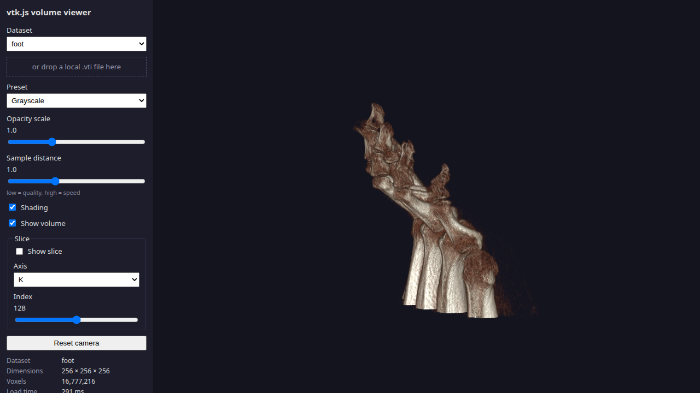
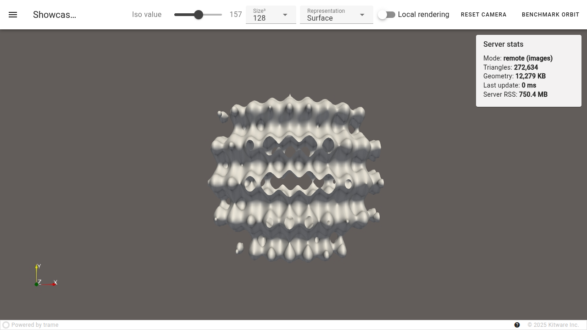

# vtkjs-pvweb-eval

An evaluation of "VTK.js + ParaViewWeb" as of October 2026, built as two independent showcases that share datasets and a benchmark harness: **Showcase A** renders a volume entirely in the browser with vtk.js (WebGL2, no server code), and **Showcase B** serves a ParaView 6.2 pipeline through trame/wslink, switching live between server-side image streaming (remote) and browser-side rendering of streamed geometry (local). The design is in [`DESIGN.md`](DESIGN.md).

| Showcase A: vtk.js volume viewer | Showcase B: trame + ParaView |
| --- | --- |
|  |  |

*(Development screenshots rendered with software GL; final GPU screenshots are listed in `report/screenshots.md`.)*

## Tested on

Copied from [`setup/versions.md`](setup/versions.md).

| Component | Version |
| --- | --- |
| OS | Pop!_OS (Linux 7.0.11, x86_64), native. Windows/PowerShell scripts are written but **not yet tested** |
| GPU | Intel Iris Xe (integrated) |
| Node.js / npm | 24.13.0 / 11.6.2 (design target: 22 LTS) |
| Vite / @kitware/vtk.js | 8.3.5 / 37.4.6 (pinned exact) |
| ParaView | 6.2.0 (bundled Python 3.12.14) |
| Python (venvs) | 3.12.3 |
| trame / trame-vtk / trame-vuetify | 4.0.0 / 2.11.17 / 3.3.0 |
| vtk (pip, `.venv` only) | 9.7.1 |

## Prerequisites

* **Node.js 22+** and npm 10+.
* **Python 3.12** (a separate install; its minor version must match ParaView's bundled Python). On Linux also `python3.12-venv`.
* **ParaView 6.2.0** (binary download from https://www.paraview.org/download/). Skip it if you only want Showcase A and the fallback (`--no-paraview`).
* Chrome or Edge (DevTools metrics and `performance.memory` are Chromium-only).
* About 1.5 GB free disk (ParaView itself is ~2 GB extracted if you install it). The repo stays under 20 MB; datasets, venvs and `node_modules` are git-ignored.

## Quickstart

**Linux / WSL2**

```bash
git clone <this repo> vtkjs-pvweb-eval && cd vtkjs-pvweb-eval
export PVPYTHON=$HOME/opt/ParaView-6.2.0-MPI-Linux-Python3.12-x86_64/bin/pvpython   # path to your pvpython
scripts/setup.sh            # venvs, npm ci, data download + conversion, environment checks
scripts/run_a.sh            # http://localhost:5173   (or: scripts/run_b.sh -> http://localhost:8080)
```

**Windows (PowerShell)**

```powershell
git clone <this repo> C:\dev\vtkjs-pvweb-eval; cd C:\dev\vtkjs-pvweb-eval
$env:PVPYTHON = "C:\Program Files\ParaView 6.2.0\bin\pvpython.exe"
scripts\setup.ps1
scripts\run_a.ps1
```

If PowerShell refuses to run scripts: `Set-ExecutionPolicy -Scope CurrentUser RemoteSigned`. Keep the repo out of OneDrive and paths with spaces (Vite's file watcher misses changes). Expect a Windows Firewall prompt for `pvpython.exe` on first run.

`setup` flags: `--skip-data` (`-SkipData`) skips the download; `--no-paraview` (`-NoParaview`) skips the ParaView steps for a fallback-only setup. Setup is idempotent: re-running skips finished work. If `pvpython` is not on `PATH`, set `PVPYTHON`; the script also checks `~/opt/ParaView-6.2.0-*/bin/` and `C:\Program Files\ParaView 6.2.0\bin\`.

## Running the showcases

| Script | What it starts | URL |
| --- | --- | --- |
| `scripts/run_a` | Showcase A, Vite dev server | http://localhost:5173 |
| `scripts/run_b [args]` | Showcase B under `pvpython --venv .pvenv` | http://localhost:8080 |
| `scripts/run_b_fallback [args]` | Showcase B with plain VTK, no ParaView | http://localhost:8081 |

**Showcase A.** Pick a dataset (or drop a local `.vti` onto the page), a transfer-function preset, and tune opacity and sample distance. The slice panel shows an I/J/K slice in the same scene. The info panel shows dimensions, load time and the WebGL renderer. Dragging the volume updates the FPS overlay. `npm run build` makes a static `dist/` (no server code needed); `npm run verify-data` checks that vtk.js parses every converted volume.

**Showcase B.** Wavelet → Contour (RTData) on the server. Toolbar: iso value, grid size (64/128/256), representation, **Local rendering** switch, reset camera and **Benchmark orbit** (remote mode: 180 steps of 2°). The right card shows triangles, geometry KB, last update time and server RSS. Extra arguments pass through, for example `scripts/run_b.sh --size 256 --mode local --host 0.0.0.0` (the last one allows a phone on the LAN). Every state change and orbit is appended to `bench/results/server_events.csv`.

**Fallback.** `run_b_fallback` runs the same UI and state on plain VTK in `.venv`, no ParaView needed.

## Reproducing the benchmark

Follow [`bench/protocol.md`](bench/protocol.md): Showcase A runs automatically with `?bench=1&data=foot_128.vti&frames=360&reps=3`; Showcase B runs use `bench/auto_b.mjs` (scripted orbit) or DevTools. Rows go into `bench/results/results.csv` through `bench/add_row.py`, and `bench/plot_results.py` builds the figures and `results_table.md`. Two validity limits apply: localhost has almost no network latency, and A (volume) and B (isosurface) must not be ranked against each other.

## Alternative: `paraview.envs` route (ParaView 6.2)

Instead of `.pvenv`, ParaView 6.2 can build a trame-ready environment itself (needs `uv`):

```bash
"$PVPYTHON" -m paraview.envs create trame setup/requirements-pv.txt
```

Then follow the ParaView 6.2 documentation for activating it. All scripts in this repo default to `--venv .pvenv`; this route is untested here.

## Troubleshooting

| Symptom | Fix |
| --- | --- |
| `ModuleNotFoundError: trame` under pvpython | `--venv .pvenv` must come **before** the script path. Also check pvpython's Python minor version equals the venv's (3.12) |
| Import conflicts or segfaults under pvpython | A pip `vtk` or newer numpy got into `.pvenv`. Delete `.pvenv`, rerun setup. `pvpython --venv .pvenv scripts/check_env.py --pv` guards this. Never `pip install vtk` there |
| `ensurepip` error on Windows | Create venvs with the separate Python 3.12, not with pvpython |
| Errors from `trame.ui.vuetify` or Vue 2 code | Use `vuetify3` imports and `client_type="vue3"`; else pin `trame<4` and note it |
| Showcase A page is blank, console says `events` was externalized | Already fixed (npm `events` package + alias in `vite.config.js`). Do not remove it |
| ParaView local rendering shows an empty view | trame-vtk 2.11.17 lacks a serializer for ParaView 6.2's `vtkPartitionedDataSetCollection`; `showcase-b/app.py` registers one. Remote mode is unaffected |
| Black canvas or very low FPS in Showcase A | `chrome://gpu` shows software rendering: update the GPU driver, try Edge, raise the sample-distance slider |
| Reader exception for a `.vti` | Rewrite without compression: `python data/raw_to_vti.py --name foot --compress none` (or `raw`) and note which works |
| 404 for `index.json` | Use `vtkXMLImageDataReader.parseAsArrayBuffer`, not `vtkHttpDataSetReader`, for `.vti` |
| Download slow or checksum mismatch | Re-run `python data/fetch_data.py`. The Open SciVis host refused HTTPS during development, so the manifest uses `http://` |
| A large volume freezes the tab | Stay at 256³ or below; use `foot_128` |
| Browser cannot connect | Allow `pvpython.exe` through the firewall or change the port (`--port`) |
| Vite misses file changes | Move the repo out of OneDrive / paths with spaces |
| Low remote FPS under WSL2 | WSL2 renders with Mesa software GL. Record the renderer string; it is a finding, not a bug |
| Behaviour changes after `npm install` | Never run `npm update`; use `npm ci` (versions are pinned exactly) |

## Data credits and licenses

Volumes come from the [Open Scientific Visualization Datasets](https://klacansky.com/open-scivis-datasets/) collection by Pavol Klacansky (the page states Creative Commons Attribution-NonCommercial-ShareAlike 4.0). Per-dataset acknowledgements from the listing:

* **foot**, **aneurism**: volvis.org and Philips Research, Hamburg, Germany
* **bonsai**: volvis.org and S. Roettger, VIS, University of Stuttgart
* **tooth**: GE Aircraft Engines, Evendale, Ohio, USA

`wavelet_smoke` and the Showcase B wavelet are generated by VTK/ParaView's analytic Wavelet source. Datasets are downloaded at setup and are not committed. Code is BSD-3-Clause (see `LICENSE`).

## Project structure

```
README.md, DESIGN.md, LICENSE
setup/       requirements-pv.txt, requirements-tools.txt, versions.md
scripts/     setup, run_a, run_b, run_b_fallback (.sh and .ps1), check_env.py
data/        manifest.json, fetch_data.py, raw_to_vti.py (raw/ and vti/ are git-ignored)
showcase-a/  Vite + vtk.js: src/main.js, viewer.js, presets.js, ui.js, bench.js, verify_vti.mjs
showcase-b/  app.py (ParaView), app_vtk.py (fallback), ui.py (shared layout and instrumentation)
bench/       protocol.md, sysinfo.py, add_row.py, plot_results.py, auto_b.mjs, results/
report/      outline, install_log, ISO 25010 evidence, screenshots, references, slides, demo script, figures/
docs/        progress.md
```
