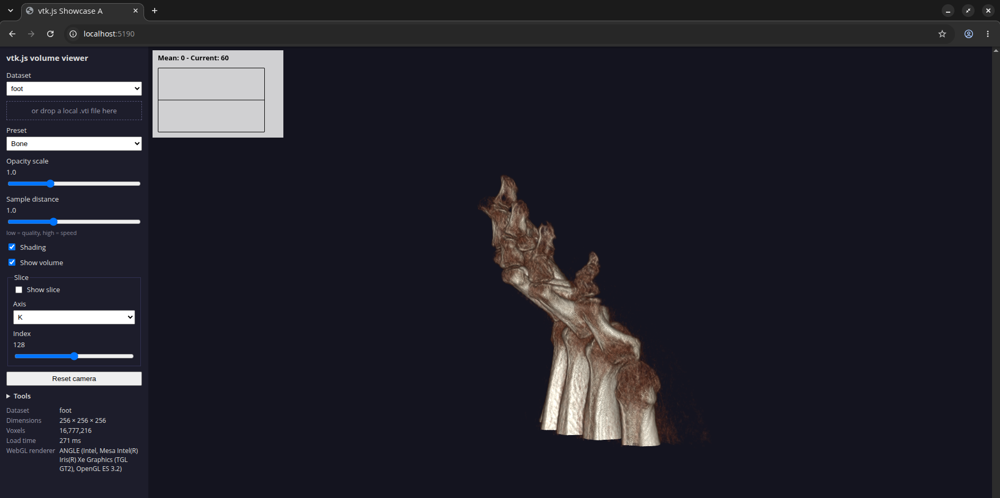
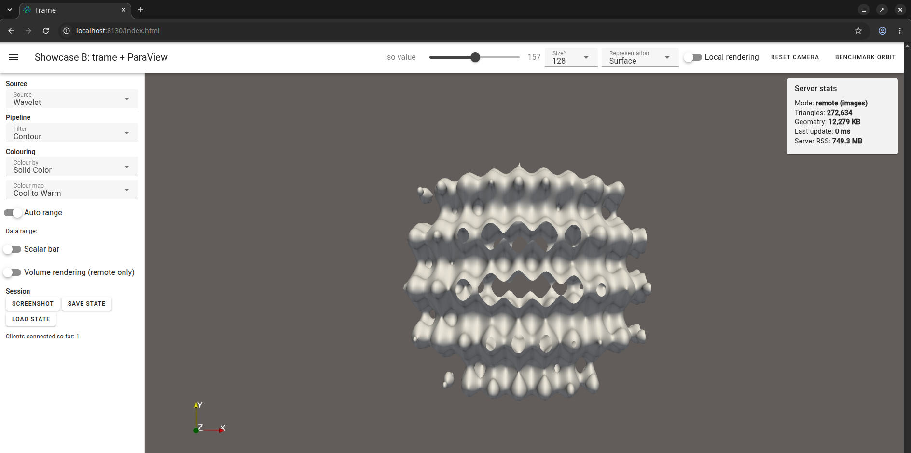

# vtkjs-pvweb-eval

This project compares two ways of getting 3D scientific data into a web browser, using Kitware's stack as it stands in October 2026. It was started as "VTK.js + ParaViewWeb". ParaViewWeb is now in maintenance mode and Kitware points people to trame, so the project evaluates vtk.js and ParaView 6.2 with trame instead.

There are two showcases that share datasets and a benchmark harness:

* **Showcase A** renders a volume entirely in the browser with vtk.js (WebGL2). There is no server code.
* **Showcase B** runs a ParaView pipeline on a trame server. You can switch live between two modes: the server renders and streams images (remote), or the server sends the geometry once and the browser renders it (local).

The written report is [`report/EVALUATION OF VISUALISATION SYSTEMS.pdf`](report/EVALUATION%20OF%20VISUALISATION%20SYSTEMS.pdf).

| Showcase A: vtk.js volume viewer | Showcase B: trame + ParaView |
| --- | --- |
|  |  |

## What it was tested on

Everything here was run on one laptop. The full list is in [`setup/versions.md`](setup/versions.md).

| Component | Version |
| --- | --- |
| OS | Pop!_OS (Linux 7.0.11, x86_64), native. The Windows PowerShell scripts are written but **not tested** |
| GPU | Intel Iris Xe (integrated) |
| Node.js / npm | 24.13.0 / 11.6.2 (the design aimed at 22 LTS) |
| Vite / @kitware/vtk.js | 8.3.5 / 37.4.6, pinned exactly |
| ParaView | 6.2.0 (bundled Python 3.12.14) |
| Python (virtual environments) | 3.12.3 |
| trame / trame-vtk / trame-vuetify | 4.0.0 / 2.11.17 / 3.3.0 |
| vtk (pip, `.venv` only) | 9.7.1 |

## What you need first

* **Node.js 22 or newer** and npm 10 or newer.
* **Python 3.12.** It has to be a separate install, and its minor version must match the Python bundled with ParaView. On Linux you also need `python3.12-venv`.
* **ParaView 6.2.0**, from https://www.paraview.org/download/. If you only want Showcase A and the plain-VTK fallback, skip it and pass `--no-paraview` to setup.
* **Chrome or Edge.** The memory numbers in the benchmark use Chromium-only browser features.
* **Disk space.** ParaView is a 901 MB download and about 2 GB once unpacked. The repository itself is small, because datasets, virtual environments and `node_modules` are git-ignored.

## Quickstart

**Linux or WSL2**

```bash
git clone <this repo> vtkjs-pvweb-eval && cd vtkjs-pvweb-eval
export PVPYTHON=$HOME/opt/ParaView-6.2.0-MPI-Linux-Python3.12-x86_64/bin/pvpython   # your pvpython
scripts/setup.sh            # environments, npm ci, data download and conversion, checks
scripts/run_a.sh            # http://localhost:5173   (or scripts/run_b.sh for http://localhost:8080)
```

**Windows (PowerShell)**

```powershell
git clone <this repo> C:\dev\vtkjs-pvweb-eval; cd C:\dev\vtkjs-pvweb-eval
$env:PVPYTHON = "C:\Program Files\ParaView 6.2.0\bin\pvpython.exe"
scripts\setup.ps1
scripts\run_a.ps1
```

A few Windows notes: if PowerShell refuses to run the scripts, use `Set-ExecutionPolicy -Scope CurrentUser RemoteSigned`. Keep the repository out of OneDrive and out of folders with spaces in the name, because Vite's file watcher misses changes there. Windows Firewall will probably ask about `pvpython.exe` the first time.

Setup flags:

* `--skip-data` (`-SkipData` on Windows) skips the dataset download.
* `--no-paraview` (`-NoParaview`) skips the ParaView steps, for a fallback-only setup.

Setup is safe to run again: it skips anything already done. If `pvpython` is not on your `PATH`, set `PVPYTHON`. The script also looks in `~/opt/ParaView-6.2.0-*/bin/` and `C:\Program Files\ParaView 6.2.0\bin\`.

To check that a fresh clone works end to end, run `scripts/cleanroom_test.sh`. It clones the repository into a temporary folder, runs setup, starts both showcases and the fallback, and prints a pass/fail table. If the dataset host is slow, point `DATA_FROM` at a folder that already has the `.raw` files.

## Running the showcases

| Script | What it starts | URL |
| --- | --- | --- |
| `scripts/run_a` | Showcase A (Vite dev server) | http://localhost:5173 |
| `scripts/run_b [args]` | Showcase B under `pvpython --venv .pvenv` | http://localhost:8080 |
| `scripts/run_b_fallback [args]` | Showcase B with plain VTK, no ParaView | http://localhost:8081 |

`run_b.sh` checks that its port is free and tells you if it isn't. You can pick another port with `PORT=8081 scripts/run_b.sh`.

**Showcase A.** Choose a dataset (or drop a local `.vti` file onto the page), pick a transfer-function preset, and adjust opacity and sample distance. The slice panel shows an I, J or K slice in the same scene, and the info panel shows the dimensions, the load time and the WebGL renderer. An FPS overlay updates while you drag the volume. `npm run build` makes a static `dist/` folder that needs no server, and `npm run verify-data` checks that vtk.js can parse every converted volume.

**Showcase B.** The pipeline is a Wavelet source and a Contour filter on the server. The toolbar has the iso value, the grid size (64, 128 or 256), the representation, the **Local rendering** switch, Reset camera and **Benchmark orbit** (remote mode: 180 steps of 2 degrees). A card on the right shows the triangle count, the geometry size, the time of the last update and the server's memory. Extra arguments are passed through, for example `scripts/run_b.sh --size 256 --mode local --host 0.0.0.0` (the last one lets a phone on your network connect). Every state change and orbit is appended to `bench/results/server_events.csv`.

**Fallback.** `run_b_fallback` runs the same interface and state on plain VTK in `.venv`, so it works without ParaView.

## Features

Details for each feature, including run output and the vtk.js or ParaView call behind it, are in `report/features_a_log.md`, `report/features_b_log.md` and `report/features_d_log.md`. The comparison with ParaView and the legacy ParaViewWeb apps is in `report/feature_matrix.md`. The screenshots named `report/figures/feat_*.png` are development shots from headless Chrome with software rendering. The `real_*.png` shots were taken in a normal Chrome window on the real GPU.

**Showcase A (vtk.js).** Open the collapsible **Tools** section in the control panel.

| Tool | What it does |
| --- | --- |
| Isosurface | Marching cubes in the browser. The slider recomputes when you release it, and shows the triangle count and the time taken |
| Orthogonal slices | I, J and K slices together with the volume |
| Probe | Click the 3D view to get the world position, the IJK index and the nearest voxel value |
| Clipping | Min and max planes on each axis for the volume and the isosurface (six planes) |
| Legend and axes | A scalar bar and an orientation-axes widget |
| Transfer function editor | Tick "Edit opacity" and drag the opacity handles (this overrides the preset opacity) |
| Mesh | Load the sample torus, use the file input, or drop a `.vtp`, `.stl` or `.obj` on the page. Only `.obj` has been tested |
| Measure and export | A distance line (two clicks, world units, on a plane facing the camera) and "Save screenshot (PNG)" |
| WebGPU probe | Open `?api=webgpu` to select the WebGPU view and add a WebGPU row to the info list. It is partial, see the limits below |

**Showcase B (trame + ParaView).** Open the **Pipeline drawer** with the menu icon.

| Section | What it does |
| --- | --- |
| Source | Wavelet, or a "VTI file" from `data/vti` (default `foot_64.vti`) |
| Filter | Contour, Slice, Clip, Threshold, Streamlines or Glyph. Streamlines and Glyph use a gradient vector array |
| Colouring | Colour by an array, nine colour maps, automatic or manual range, and a scalar bar (remote mode only) |
| Volume rendering | Server-side volume rendering of the source, remote mode only |
| Session | Screenshot, Save state and Load state. Load restores the app's own `showcase-b/out/state.json`; the `.pvsm` file is written but not reloaded |

Several browsers can open the same server and share one session: one filter, one camera, one image stream. There is no separate session per user. The original toolbar, the local/remote switch and the Benchmark orbit work as before.

**Topology app (`showcase-b/app_topology.py`).** This is a separate trame app that uses the Topology ToolKit (TTK 1.3.0). It comes bundled with the ParaView 6.2.0 binary as the `TopologyToolKit` plugin, so nothing extra is installed. The sources are the Wavelet, a field made of five Gaussians (where the right answer is known), or any `data/vti/*.vti`, resampled to N³ (default 48). It computes persistence pairs and shows the critical points (minima, saddles, maxima) over a mid-slice, with the persistence diagram drawn as an SVG. The persistence slider takes effect when you release it. On Linux:

```bash
export PVPYTHON=$HOME/opt/ParaView-6.2.0-MPI-Linux-Python3.12-x86_64/bin/pvpython
$PVPYTHON --venv .pvenv showcase-b/app_topology.py --port 8120 --server [--res 48]
# open http://localhost:8120/   (the first computation takes about 5 to 8 seconds)
$PVPYTHON --venv .pvenv showcase-b/validate_topology.py   # headless check, prints PASS or FAIL
```

There is no Windows wrapper or Windows command for this app. It has only been run on Linux.

### Extras

These were added after the main work. They are not part of the benchmark.

* **GitHub Pages.** `.github/workflows/pages.yml` and `showcase-a/scripts/pages_build.mjs` build a small public copy of Showcase A with only the `tooth` and `foot_128` datasets (about 2 MB, in `showcase-a/pages-data/`). The build was tested locally from a sub-path. The workflow has never run on GitHub, and Pages has to be switched on in the repository settings (Settings, Pages, Source: GitHub Actions). Details are in `report/extras/e1_github_pages.md`.
* **Jupyter.** `notebooks/trame_in_jupyter.ipynb` runs the Showcase B pipeline inside JupyterLab with an iso slider. It needs its own environment (`.jvenv`, about 270 MB) and a kernel that runs on `pvpython`: install the packages from `setup/requirements-jupyter.txt`, run `scripts/install_jupyter_kernel.sh`, start `jupyter lab` from a real desktop session, and pick the kernel "ParaView 6.2 pvpython". It was tested on Linux in headless Chrome. See `report/extras/e8_jupyter.md`.
* **WebXR.** Showcase A has an "Enter VR" button in the Tools section. It only appears enabled if the browser reports an XR device. It was tested with an XR emulator, never with a real headset. See `report/extras/e10_webxr.md`.

### Known limits

* WebGPU is partial. In headless Chrome the adapter was a software one, the console showed "No input!" errors and the tab closed, so no WebGPU image was produced. It has not been tried on a real GPU.
* Windows, Firefox and Edge are untested, for the features as well as for the base apps.
* The browser isosurface runs on the main thread, so the page is blocked while it computes. 256³ volumes were not timed.
* In Showcase B the scalar bar and volume rendering exist in remote mode only. Local mode colours the geometry but has no scalar bar.
* The persistence diagram in the topology app is the app's own SVG, not a ParaView chart view. Persistence is computed on the resampled N³ grid.
* `TTKPersistenceDiagram` crashes pvpython (a segmentation fault) if you don't name the scalar field. The app always names it.
* `pvpython --venv .pvenv` may import numpy from `~/.local` (your user site) instead of ParaView's own numpy (see `features_d_log.md`).
* While Showcase B's pipelines are switched, the server's memory use keeps growing and does not fall back. The cause was not investigated.
* `bench/results/server_events.csv` is only meaningful for the benchmark rows. Feature tests add rows of their own, so filter by timestamp.

## Reproducing the benchmark

Follow [`bench/protocol.md`](bench/protocol.md). Showcase A runs by itself with `?bench=1&data=foot_128.vti&frames=360&reps=3`. For Showcase B, `bench/run_all_b.sh` runs every cell (local and remote, three sizes, three repetitions) with a scripted mouse orbit from `bench/auto_b.mjs`, and `bench/orbit_check.sh` re-measures the server-side orbit at several window sizes. Results go into `bench/results/results.csv` through `bench/add_row.py`, and `bench/plot_results.py` builds the figures and `results_table.md`.

Two limits to keep in mind when reading the numbers. Localhost has almost no network delay, which helps remote rendering. And A (a volume) and B (an isosurface) draw different things, so their frame rates should not be ranked against each other.

## Alternative: the `paraview.envs` route

Instead of `.pvenv`, ParaView 6.2 can build a trame-ready environment itself. It needs `uv`:

```bash
"$PVPYTHON" -m paraview.envs create trame setup/requirements-pv.txt
```

Then follow the ParaView 6.2 documentation to activate it. Every script here uses `--venv .pvenv` by default, and this route has not been tried.

## Troubleshooting

| What you see | What to do |
| --- | --- |
| `ModuleNotFoundError: trame` under pvpython | `--venv .pvenv` has to come **before** the script path. Also check that pvpython's Python minor version equals the environment's (3.12) |
| Import conflicts or crashes under pvpython | A pip `vtk` or a newer numpy got into `.pvenv`. Delete `.pvenv` and run setup again. `pvpython --venv .pvenv scripts/check_env.py --pv` checks for this. Never `pip install vtk` there |
| `ensurepip` error on Windows | Create the environments with the separate Python 3.12, not with pvpython |
| Errors from `trame.ui.vuetify` or Vue 2 code | Use `vuetify3` imports and `client_type="vue3"`. Otherwise pin `trame<4` and note it |
| Showcase A shows a blank page and the console says `events` was externalized | Already fixed with the npm `events` package and an alias in `vite.config.js`. Don't remove it |
| ParaView local rendering shows an empty view | trame-vtk 2.11.17 has no serializer for ParaView 6.2's `vtkPartitionedDataSetCollection`. `showcase-b/app.py` registers one. Remote mode isn't affected |
| Black canvas or very low FPS in Showcase A | `chrome://gpu` probably shows software rendering. Update the GPU driver, try Edge, or raise the sample-distance slider |
| A `.vti` file won't read | Rewrite it without compression: `python data/raw_to_vti.py --name foot --compress none` (or `raw`), and note which one works |
| 404 for `index.json` | Use `vtkXMLImageDataReader.parseAsArrayBuffer` for `.vti`, not `vtkHttpDataSetReader` |
| Dataset download is slow, stalls, or the checksum doesn't match | Run `python data/fetch_data.py` again. It resumes partial files and gives up on very slow connections. The Open SciVis host refused HTTPS during development, so the manifest uses `http://`. If it keeps stalling, copy the `.raw` files into `data/raw/` by hand |
| A large volume freezes the tab | Stay at 256³ or smaller, or use `foot_128` |
| The browser can't connect | Allow `pvpython.exe` through the firewall, or change the port with `--port` |
| Showcase B won't start: "port already in use" | An earlier server is still running. Stop it (`fuser -k 8080/tcp`) or use `PORT=8081 scripts/run_b.sh` |
| Vite misses file changes | Move the repository out of OneDrive and out of folders with spaces |
| Low remote FPS under WSL2 | WSL2 renders with Mesa software GL. Record the renderer string, because it's a finding and not a bug |
| Things change after `npm install` | Never run `npm update`. Use `npm ci`, because the versions are pinned exactly |

## Data credits and licences

The volumes come from the [Open Scientific Visualization Datasets](https://klacansky.com/open-scivis-datasets/) collection by Pavol Klacansky. The page states the Creative Commons Attribution-NonCommercial-ShareAlike 4.0 licence. The collection credits the datasets like this:

* **foot** and **aneurism**: volvis.org and Philips Research, Hamburg, Germany
* **bonsai**: volvis.org and S. Roettger, VIS, University of Stuttgart
* **tooth**: GE Aircraft Engines, Evendale, Ohio, USA

The `wavelet_smoke` volume and Showcase B's wavelet are generated by the analytic Wavelet source in VTK and ParaView. Datasets are downloaded during setup and are not committed (the only exception is the two small converted files for the Pages build). The code is BSD-3-Clause, see `LICENSE`.

## Project layout

```
README.md, LICENSE
setup/       requirements-pv.txt, -tools.txt, -topology.txt, -jupyter.txt, versions.md
scripts/     setup, run_a, run_b, run_b_fallback (.sh and .ps1), check_env.py,
             cleanroom_test.sh, install_jupyter_kernel.sh
data/        manifest.json, fetch_data.py, raw_to_vti.py (raw/ and vti/ are git-ignored)
showcase-a/  Vite + vtk.js: src/main.js, viewer.js, presets.js, ui.js, bench.js,
             tools/ (index.js, mesh.js, webgpu.js), xr/, verify_vti.mjs, gen_sample_mesh.mjs,
             scripts/pages_build.mjs, pages-data/, public/mesh/sample_torus.obj
showcase-b/  app.py (ParaView), app_vtk.py (fallback), ui.py (layout, Pipeline drawer, instrumentation),
             app_topology.py, validate_topology.py
bench/       protocol.md, sysinfo.py, add_row.py, plot_results.py, auto_b.mjs, run_all_b.sh,
             orbit_check.sh, results/
notebooks/   trame_in_jupyter.ipynb
.github/     workflows/pages.yml
report/      the report draft and notes: install_log, ISO 25010 evidence, feature_matrix,
             feature logs, references, extras/, figures/
```
